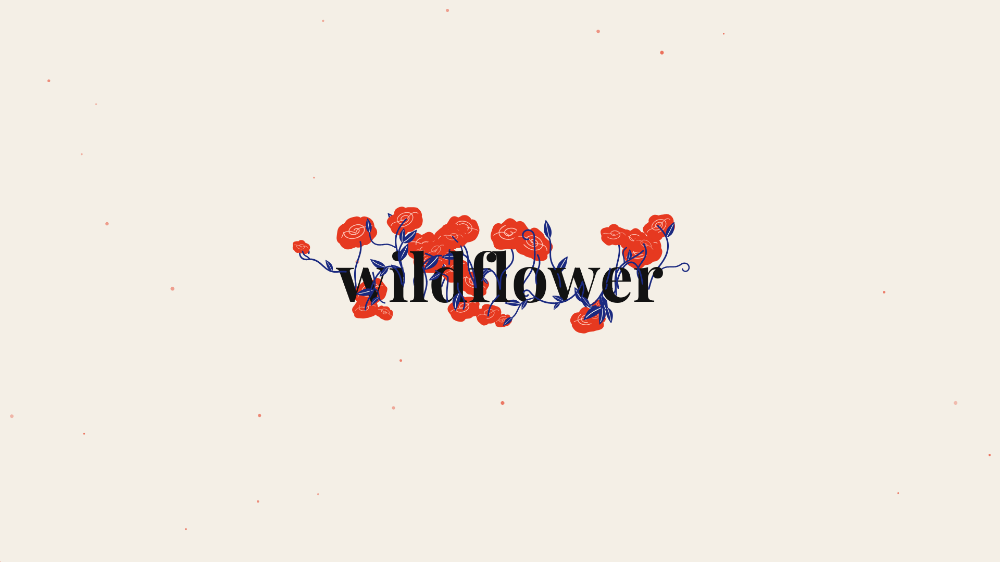
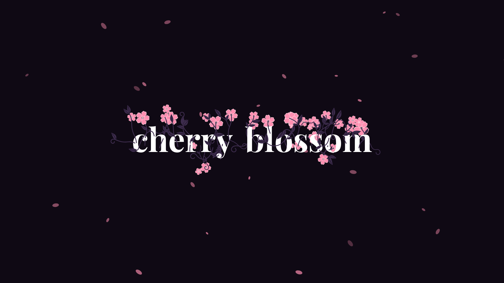
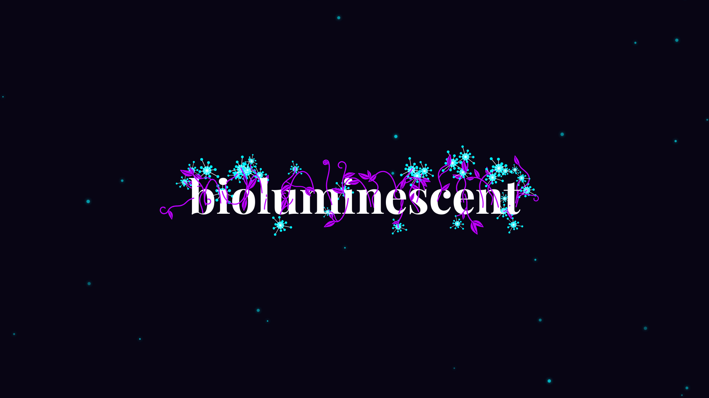
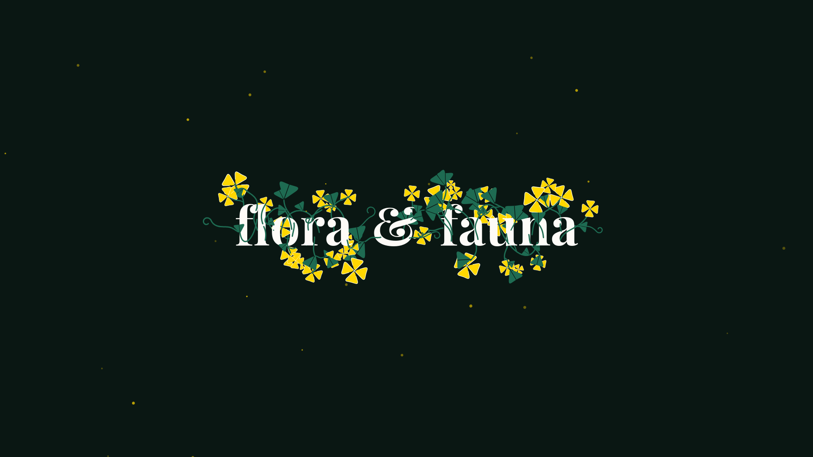
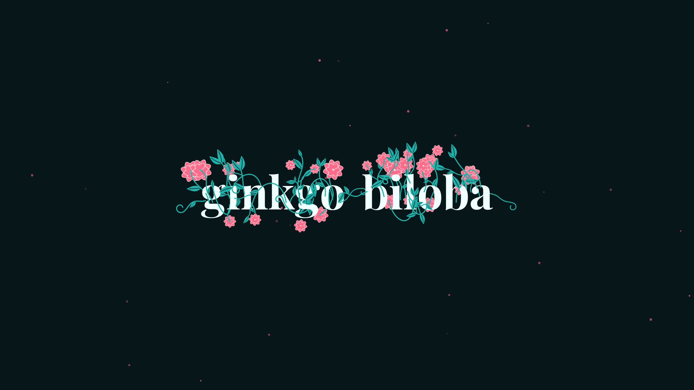
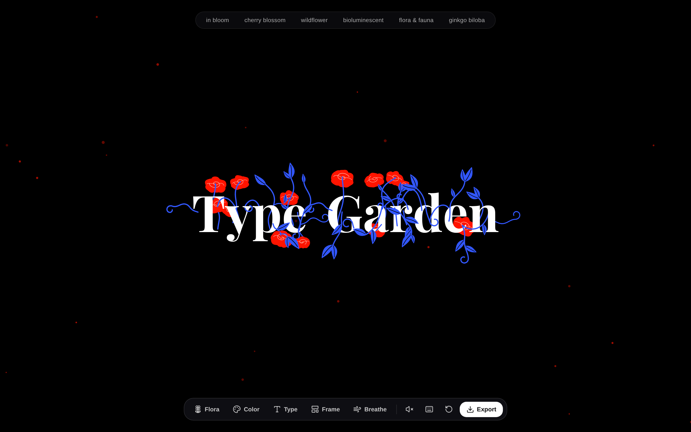

# Type Garden

Type Garden is a generative living typography studio. Type letters onto the canvas and watch them grow into botanical forms, with flowers, leaves, stems, motion, and atmospheric details emerging from the text.

## Features

- Procedural botanical lettering with five flora species
- Interactive text input, hover response, and planted flowers
- Botanical species, color palette, typeface, canvas ratio, and motion preset controls
- PNG poster, SVG path, and four-second video export
- Optional interaction sound effects
- Responsive canvas layouts for screen, square, poster, and story formats

## Gallery

| Wild Rose | Sakura |
| --- | --- |
|  |  |

| Bioluminescence | Golden Ginkgo |
| --- | --- |
|  |  |

| Emerald Lotus | Type Garden |
| --- | --- |
|  |  |

## Run locally

Requires Node.js and npm.

```bash
npm install
npm run dev
```

Open the local URL printed by Vite, usually `http://localhost:5173`.

## Build

```bash
npm run build
npm run preview
```

## Project layout

- `src/` contains the React interface, canvas renderer, botanical engine, palettes, and audio engine.
- `docs/screenshots/` contains the README gallery images.
- `scripts/` contains screenshot helpers.
